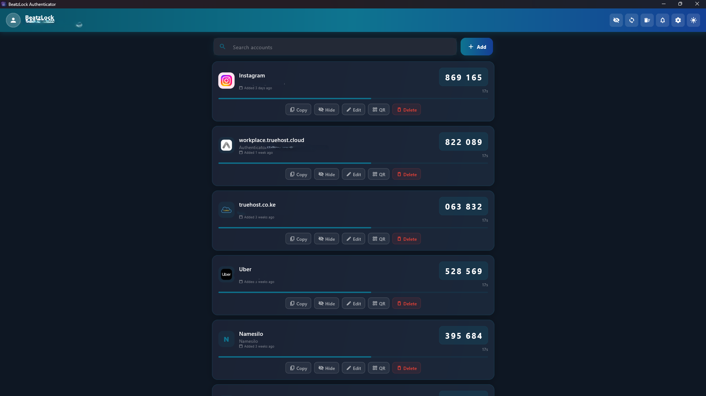
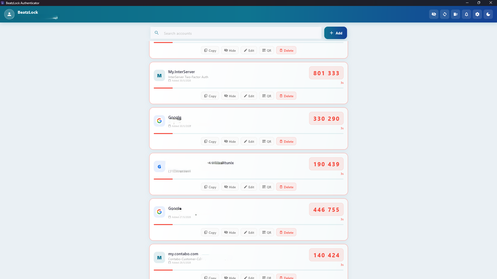
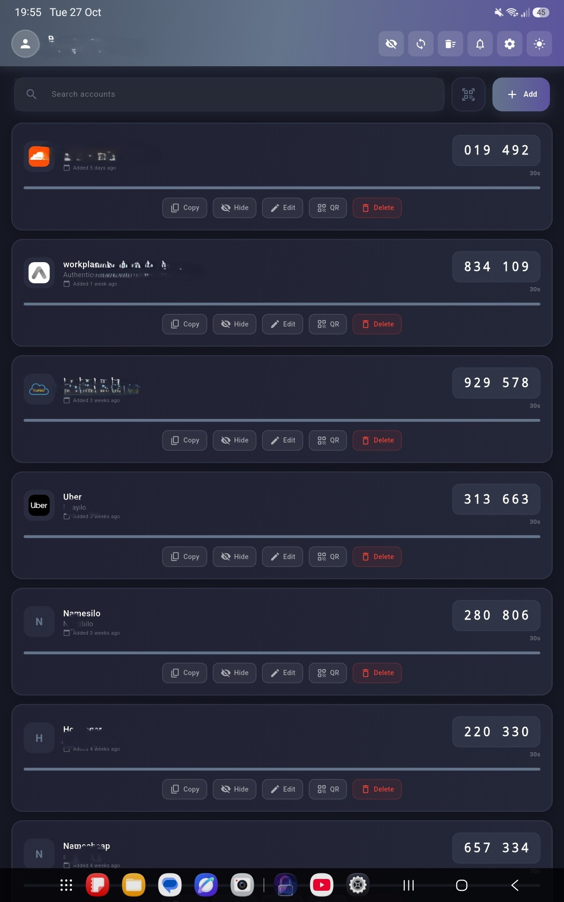
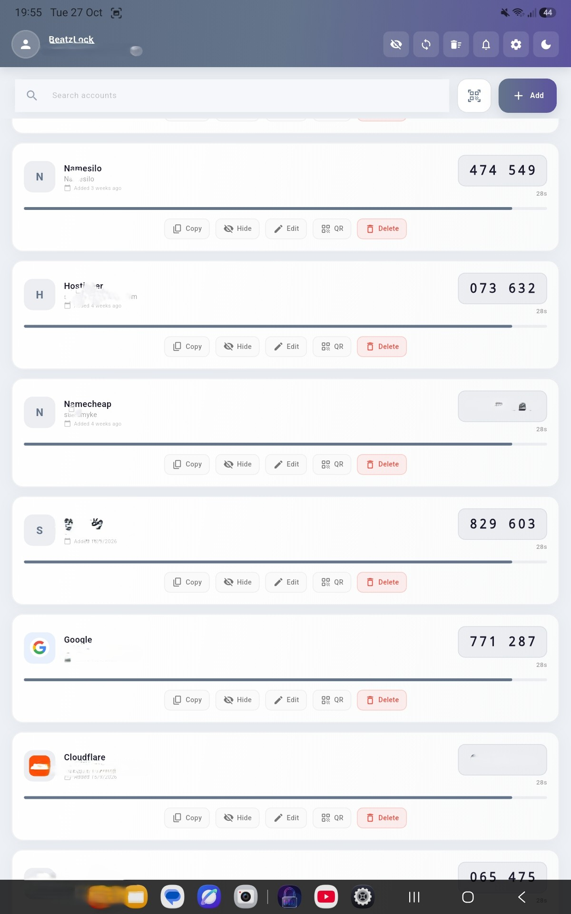
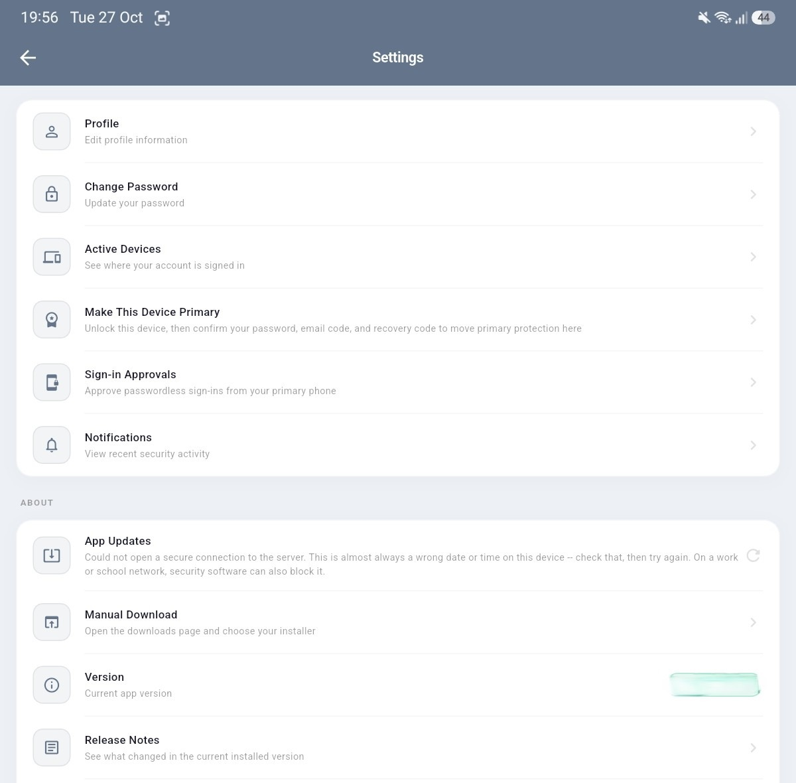

# BeatzLock

BeatzLock is a self-hosted two-factor authentication (TOTP) authenticator,
built as three independent projects that share a checkout but nothing else:

```text
beatzlock_project/
├── beatzlock_app/     downloads & ratings site   (Django)
├── otp_backend/       authenticator API          (Django)
├── otp_auth_app/      Flutter client + native build tooling
├── build.py           wrapper that runs otp_auth_app/build.py
└── github.py          git identity helper
```

Each project owns everything it needs — its own `.env`, `requirements.txt`,
virtualenv, static files and templates — so working on one never means
reading the other.

## Screenshots

| | |
|---|---|
|  |  |
|  |  |



## The two Django projects

Separate settings, separate databases, separate `auth_user` tables.

| | Downloads site | Authenticator API |
|---|---|---|
| Where | `./beatzlock_app/` | `./otp_backend/` |
| Settings | `beatzlock_app/config/settings.py` | `otp_backend/otp_backend/settings.py` |
| `.env` | `beatzlock_app/.env` | `otp_backend/.env` |
| WSGI | `config.wsgi` | `otp_backend.wsgi` |
| Dev port | `8005` | `8000` |
| Admin | `/beatzlock-admin/` | `/beatzlock_admin/` |
| Sign-in | email address | email address |
| Django apps | `beatzlock_app`, `console` | `accounts`, `api`, `twofa`, `beatzlocklogs` |
| Static | `beatzlock_app/static/` + each app's own `static/` | `otp_backend/static/` |

### What each one serves

**Downloads site** — `/downloads/`, `/downloads/archive/`, `/rate/`,
`/legal/terms-of-service/`, `/legal/privacy-policy/`, the `/api/update-check/`
and `/api/ratings/…` JSON the native apps read, and a staff console at
`/console/stats/`, `/console/review-replies/`, `/console/build-history/`.

**Authenticator API** — `/api/` for the native clients: auth, sync, device
sessions, passwordless login, backup codes, 2FA and recovery codes, plus a
log viewer at `/beatzlock_admin/logs/`. `/` redirects to the main site.

### Signing in

Both projects sign people in by **email address**. Neither asks for a
username anywhere: not on the sign-in page, not in the admin.

**`otp_backend` has no username, first name or last name at all.** Its
`AUTH_USER_MODEL` is `users.User` — an email address, a password, and the
staff/superuser flags. The model keeps `auth_user` as its table name so the
switch was a column drop rather than a table rebuild. `email` carries the
unique constraint `username` used to, and is stored lowercased.
`accounts/identity.py` resolves an account one way only: by address.

The API still *accepts* a `username` key in request bodies and still returns
one in auth responses, both carrying the email — that's wire compatibility
for app builds that read `user["username"]` and anchor their local vault to
it; it is not a second identifier. See `api/serializers.py`.

**`beatzlock_app` still uses Django's stock `auth.User`.** It keeps
`username` equal to the email, and `beatzlock_app/beatzlock_app/identity.py`
resolves an email first with a username fallback for older rows.

### Migrating an existing API database

The `AUTH_USER_MODEL` swap means every applied migration with an account
foreign key depends on `users.0001_initial`, which an existing database has
never applied — Django refuses to run `migrate` until that's recorded:

```bash
python manage.py adopt_user_table   # records users.0001_initial; no-op if already done
python manage.py migrate            # drops the old username/first/last columns
```

`migrate` prints any account whose username was not its email address before
dropping the column: those accounts' next *fresh* sign-in derives a different
vault key than the one their synced data was encrypted with, because the app
derives that key from whatever the API returns as `user["username"]`.
Installs that are already signed in keep the key they stored.

## Local development

Neither `.env` is committed. Each settings module reads its database,
secret key, allowed hosts and mail credentials from its own `.env` — write
one for each project before running it.

**Downloads site:**

```bash
cd beatzlock_app
python -m venv beatzlock_v_env && . beatzlock_v_env/Scripts/activate   # Windows
pip install -r requirements.txt
python manage.py migrate
python manage.py runserver 8005
```

**Authenticator API:**

```bash
cd otp_backend
python -m venv totp_v_env && . totp_v_env/Scripts/activate
pip install -r requirements.txt
python manage.py migrate
python manage.py runserver 8000
```

### local.py

`beatzlock_app/config/local.py` and `otp_backend/otp_backend/local.py` are
git-ignored, development-only overrides. Each settings module imports its own
immediately after `DEBUG` is read from `.env` — the static files storage, the
WhiteNoise middleware, `ALLOWED_HOSTS`, the secure-cookie flags all key off
it, so one line there switches all of them together:

```python
# beatzlock_app/config/local.py
DEBUG = True
```

Without a `local.py`, `runserver` runs with whatever `DEBUG` your `.env`
sets. With `DEBUG=False` and no `local.py`, static files are resolved
through a manifest that only `collectstatic` writes, so the first page can
fail with `Missing staticfiles manifest entry`.

Set `USE_X_ACCEL_REDIRECT=False` in the downloads site's `.env` for local
work: in production, nginx streams app binaries via `X-Accel-Redirect`
(`beatzlock_app/beatzlock_app/utils/file_serving.py`), and there's no nginx
in front of `runserver` locally.

## The Flutter client

`otp_auth_app/` is self-contained: the Dart source, the Windows installer
inputs (`inno_script/`, `vc_redist/`), the build logs and every build output
live inside it. Nothing it produces is written outside that folder.

### Where its endpoints come from

Every URL the app calls is in `lib/config/app_config.dart`. Each environment
is built from one base string per server:

| | Authenticator API | Downloads site |
|---|---|---|
| Desktop dev | `http://localhost:8000/api/` | `http://localhost:8005/` |
| Android emulator dev | `http://10.0.2.2:8000/api/` | `http://10.0.2.2:8005/` |

`10.0.2.2` is the emulator's alias for the host machine's localhost.
`AppConfig.isDevelopment` chooses between a production base and the local
one above — set your own deployment's production URLs there.

| `AppConfig` member | Path | What answers it |
|---|---|---|
| `updateApiUrl` | `api/update-check/` | update check, including release notes |
| `legalDocumentApiUrl(type)` | `api/legal/<type>/` | terms / privacy as JSON |
| `legalDocumentWebUrl(type)` | `legal/terms-of-service/`, `legal/privacy-policy/` | the same documents as web pages |
| `ratingsApiUrl`, `myRatingApiUrl`, `ratingSubmitApiUrl`, `ratingDeleteApiUrl` | `api/ratings/…` | reviews |
| `rateAppUrl` | `rate/` | the review form |
| `manualDownloadUrl` | `downloads/` | the downloads page |

### The update check

```text
GET /api/update-check/?platform=<platform>&version=<version>&build_number=<n>
```

Add `&linux_distribution=<distro>` for Linux builds. The response carries
`update_available`, `force_update`, `latest_version`, `latest_build_number`,
`download_url`, `downloads_page_url`, `release_notes` and a human-readable
`reason`. An update is forced once a client is five or more releases or
builds behind. `download_url` and `downloads_page_url` are reversed from the
site's `urls.py`, never written out by hand.

### Developing against the local servers

Three terminals — both Django projects, then the client:

```bash
cd beatzlock_app && python manage.py runserver 8005   # downloads site
cd otp_backend  && python manage.py runserver 8000    # authenticator API
cd otp_auth_app && flutter pub get && flutter run -d windows
```

Set `isDevelopment = true` in `lib/config/app_config.dart` first, and set it
back before building anything you intend to release. Use `-d linux`, `-d
android` or `-d windows` to pick the target; the platform sections below
cover each one in detail.

### Releasing a build

1. **Build.** `python3 build.py` from the repo root opens the menu. Artifacts
   land in `otp_auth_app/final_builds/<platform>/<version>/`, and the
   metadata for each one is appended to
   `otp_auth_app/build_logs/<platform>/build_log.json`.
2. **Publish.** In the downloads site admin, create the **App Release** first
   — version, build number and the release-notes `.txt`, which covers every
   platform — then add one **Platform Build** per binary pointing at it.
3. **Check the history.** `/console/build-history/` lists what was built,
   reading `otp_auth_app/build_logs/` next to the site.
4. **Ship.** The next update check each client makes returns the new
   version, its notes and its download URL.

## Windows

### Debug Run

```bash
flutter clean
flutter pub get
flutter run -d windows
```

If you do not need a clean rebuild:

```bash
flutter run -d windows
```

### Release Build

```bash
flutter build windows --release
```

## Linux (Kali / Debian-based)

### Debug Run

```bash
flutter clean
flutter pub get
flutter run -d linux
```

### Release Build

```bash
flutter build linux --release
```

## Fedora Linux

Install the Fedora build tools and Flutter desktop dependencies:

```bash
sudo dnf install -y git curl unzip xz zip clang cmake gcc-c++ libstdc++-devel ninja-build pkgconf-pkg-config gtk3-devel libwebp-devel mesa-libGLU patchelf rpm-build rpmdevtools desktop-file-utils xdg-utils
```

If Flutter is not already installed, download the Linux SDK from the Flutter
SDK archive, extract it, and add Flutter to your shell path:

```bash
mkdir -p "$HOME/develop"
tar -xf ~/Downloads/flutter_linux_*.tar.xz -C "$HOME/develop"
echo 'export PATH="$HOME/develop/flutter/bin:$PATH"' >> ~/.bashrc
source ~/.bashrc
flutter doctor -v
```

Install the app packages:

```bash
cd otp_auth_app
flutter pub get
```

Debug run on Fedora:

```bash
flutter run -d linux
```

Build the Fedora RPM from the repo root:

```bash
python3 build.py
```

`build.py` is a wrapper; the real script is `otp_auth_app/build.py` and every
path it reads or writes — `inno_script/`, `vc_redist/`, `final_builds/` and
the scratch package directories — sits inside `otp_auth_app/`.

Choose option `3. Fedora .rpm final build`, or option
`1. Linux package for this distro (.deb/.rpm)` while on Fedora.

The RPM is written to:

```text
otp_auth_app/final_builds/fedora/<version_build>/beatzlock_<version_build>_x86_64.rpm
```

Install the generated RPM:

```bash
sudo dnf install ./otp_auth_app/final_builds/fedora/<version_build>/beatzlock_<version_build>_x86_64.rpm
```

## Android

Make sure an Android phone is connected with USB debugging enabled, or start
an Android emulator first.

Check available devices:

```bash
flutter devices
```

If Flutter does not detect any Android device, check `adb` first:

```bash
adb devices
```

If `adb devices` shows no connected devices, restart the ADB server and check
again:

```bash
adb kill-server
adb start-server
adb devices
```

If no physical device appears, list the available Android emulators:

```bash
flutter emulators
```

### Start an Emulator on Ubuntu

```bash
flutter emulators --launch <emulator-id>
```

### Start an Emulator on Windows

1. Open Android Studio.
2. Click `More Actions` on the welcome screen, or open `Tools > Device Manager` from a project.
3. In `Device Manager`, find your virtual device.
4. Click the `Play` button to start the emulator.
5. Wait for Android to finish booting, then run `flutter devices`.

### Debug Run

```bash
flutter clean
flutter pub get
flutter run -d android
```

### Release Build

```bash
flutter build apk --release
flutter build appbundle --release
```

## Quick start

Each project runs from its own folder:

```bash
cd beatzlock_app && python manage.py runserver 8005   # downloads site
cd otp_backend  && python manage.py runserver 8000    # authenticator API
cd otp_auth_app && flutter run -d windows              # or -d linux, -d android
```

## License

Yeah do whatever you want, I will put the lience later.
